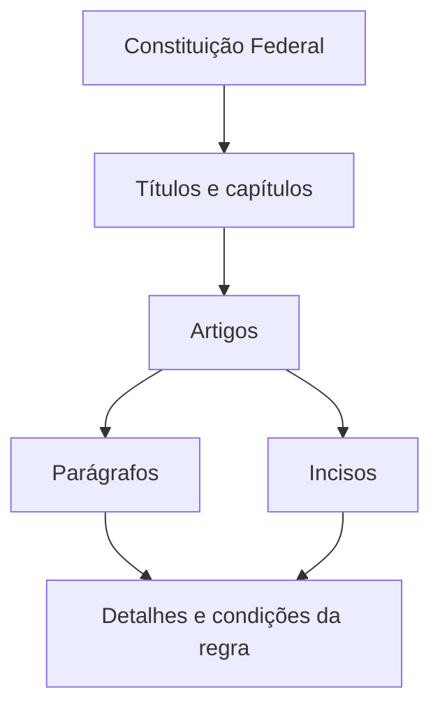

## Um ponto de partida para entender o Brasil

A Constituição Federal de 1988 estabelece as bases da organização do Estado brasileiro e reúne direitos e garantias fundamentais. Você pode começar pela estrutura do documento, sem precisar ler tudo de uma vez.

Este guia apresenta um caminho de leitura. As explicações são introdutórias; o texto da norma e as regras de aplicação de cada dispositivo devem ser consultados na fonte oficial.

> **Texto legal e explicação têm funções diferentes.** O leitor de leis preserva o texto importado. Este guia é uma camada editorial separada, não integra a Constituição e ainda não passou por revisão jurídica.

## Como o texto se organiza

A leitura costuma seguir uma hierarquia. Títulos e capítulos agrupam assuntos; artigos enunciam regras; parágrafos e incisos detalham o conteúdo.

| Elemento | O que você vai encontrar |
| --- | --- |
| Título | Um grande conjunto de assuntos |
| Capítulo | Uma divisão temática dentro do título |
| Artigo | Um dispositivo, indicado por “Art.” |
| Parágrafo | Um desdobramento do artigo, indicado por “§” ou “Parágrafo único” |
| Inciso | Uma enumeração normalmente indicada por algarismos romanos |

## Três leituras para começar

### 1. Conheça os fundamentos

O **artigo 1º** apresenta fundamentos da República, como a cidadania e a dignidade da pessoa humana. Comece por ele para reconhecer conceitos que aparecem em outras partes da Constituição.

[Ir ao artigo 1º](/leis/constituicao?parte=1#art-1)

### 2. Entenda a organização dos poderes

O **artigo 2º** enuncia os Poderes Legislativo, Executivo e Judiciário como independentes e harmônicos entre si. A organização de cada um é desenvolvida ao longo do texto.

[Ir ao artigo 2º](/leis/constituicao?parte=1#art-2)

### 3. Explore direitos e garantias

O **artigo 5º** reúne direitos e garantias individuais e coletivos. A frase inicial afirma a igualdade perante a lei; os incisos desenvolvem diferentes garantias. Leia o caput e depois os incisos, observando as condições de cada dispositivo.

[Ir ao artigo 5º](/leis/constituicao?parte=1#art-5)

## Um exemplo de navegação

Ao encontrar uma referência como **“art. 5º, inciso IV”**, procure primeiro o artigo 5º e, dentro dele, o item identificado por **IV**. A referência localiza um trecho específico; compreender seu alcance pode exigir a leitura de outros dispositivos e das normas relacionadas.

> **Confira a versão consultada.** Emendas podem alterar o texto e estabelecer regras de transição ou datas de produção de efeitos. A data de coleta da cópia não é uma garantia de vigência ou de aplicação imediata de cada redação.

## Continue no texto original

Abra o leitor para navegar pelo índice, pesquisar dentro da Constituição e consultar a fonte oficial. As explicações deste guia não substituem a publicação oficial nem a análise de uma situação concreta.

[Ler a Constituição no acervo](/leis/constituicao)

[Consultar o texto compilado no Planalto](https://www.planalto.gov.br/ccivil_03/constituicao/constituicaocompilado.htm)
