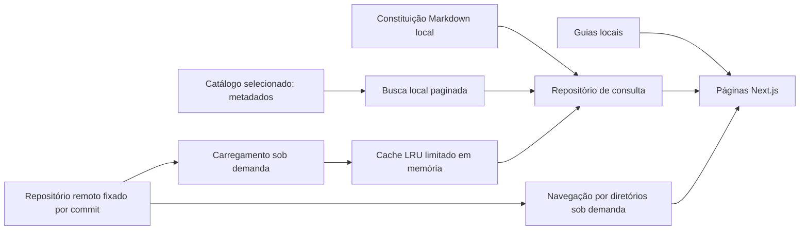

# Arquitetura atual — modelo híbrido

Decisão aprovada: Constituição e guias locais; outros textos remotos, com cache limitado. Substitui as propostas anteriores de importação integral e SQLite.

## Responsabilidades

`features/legislation/types.ts` define contratos e entidades sem dependência de framework. `parse.ts` normaliza Markdown e metadados; `remote-path.ts` restringe caminhos e define identidades remotas reversíveis. As identidades do catálogo continuam derivadas dos caminhos para preservar links.

`features/search/catalog-search.ts` pesquisa somente os metadados selecionados, com normalização e filtros. Seu custo depende desse catálogo pequeno, não da quantidade de normas no repositório.

`infrastructure/legislation.ts` seleciona Constituição local ou fonte remota e implementa o contrato assíncrono. `remote-source.ts` limita tamanho, concorrência, timeout e destinos. `bounded-cache.ts` implementa LRU com TTL e orçamento estrito para respostas frescas e expiradas. `remote-directory.ts` percorre só os diretórios solicitados, também com cache e limites.

As páginas e a geração de metadados aguardam a leitura. React cache evita duplicação dentro da mesma renderização, e o LRU deduplica consultas remotas entre requisições do processo. Não há cache nacional em disco ou no navegador.

## Disponibilidade e versões

A Constituição e o catálogo podem ser lidos sem rede. Leis remotas ainda não consultadas dependem do GitHub. Falhas não são confundidas com resultado vazio ou ausência da norma. Cache expirado só é usado dentro do orçamento e prazo documentados; o leitor sinaliza essa condição. Reinício elimina o cache.

Um commit fixo identifica a origem remota; as datas de coleta são as do documento, não a data da visita. Atualizar a versão exige uma revisão explícita, não um pull automático durante build ou execução.

## Desenvolvimento

Build não coleta leis nem depende da API do GitHub. Next observa somente a aplicação pequena. O catálogo inicial possui 19 metadados, e o único texto legal integral local é a Constituição. Não há SQLite ativo, fluxo de importação integral nem arquivo de manifesto nacional.

## Conteúdo não confiável

Texto externo é Markdown sem HTML arbitrário ou execução de JavaScript; links perigosos são filtrados e imagens externas omitidas. Caminhos aceitos pertencem às coleções jurídicas permitidas. Hosts e commit são definidos no servidor; parâmetros do visitante não se tornam URLs arbitrárias.

## Evolução

O catálogo selecionado pode crescer, mas não deve virar um arquivo nacional gigante. Antes de busca nacional completa ou produção de alto tráfego, medir a demanda e escolher um serviço de índice separado ou artefatos de catálogo particionados. Não apresentar navegação de pastas como busca jurídica ou textual nacional.
